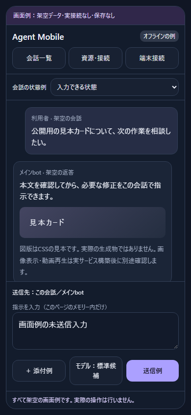

# Private Agent Mobile Blueprint（公開用下書き）

スマホから自分のAIエージェントを操作し、別マシンのGPU状況を確認するための、LLM向け設計・安全要件・受入試験集。

**これは稼働サービスでもワンクリック導入アプリでもありません。** 同梱の実行コードは公開前検査ツールと実接続しない画面例だけです。生成されたサーバーの安全性・対応OS・既存バックエンドとの互換性は、利用環境で別途検証が必要です。文書・画面例・検査コードは[MITライセンス](LICENSE)。著作権表記はamphibians-oです。安全性の保証や個別環境への導入・継続サポートを約束するものではありません。脆弱性の非公開報告はリポジトリのSecurity → Report a vulnerabilityを利用してください。

## 画面例

[操作できるオフライン画面例](examples/phone-ui.html) ／ [画面・操作と受入条件の対応](docs/SCREEN-EXAMPLES.md)。HTMLをダウンロードしてブラウザで開くと、架空データだけで操作の流れを試せます。

実URL・コード・鍵は入力しないでください。実ファイルやバックエンドには接続しません。

## 目指す形

- 同じ保存会話と正規バックエンドをスマホから利用する。別エージェントやDB直書きで競合を回避しない。
- ピン留め・活動順の直近・検索を入口にする。課題状態、担当bot、接続状態、計算資源は混同しない。
- URLを知っていても、それだけでは利用できない。ネットワーク到達制限とアプリの端末認証を独立に置く。
- ドライブ全体を配信しない。許可された成果物だけ、認証付きの不透明なIDで配信する。
- GPU監視は読み取り専用。停止、リセット、クロック変更、モデル起動は別機能としても本設計には含めない。
- 鍵、Cookie、実接続先、保存会話、個人のディレクトリ構成を公開物やLLMプロンプトへ持ち込まない。

## 最初に読む順

1. `docs/ARCHITECTURE.md` — 接続方式の選択と権限境界。
2. `docs/SECURITY-AUDIT.md` — 詳細な脅威、設計判断、残余リスク。
3. `prompts/BUILD.md` — コーディングLLMに渡す構築依頼。
4. `docs/ACCEPTANCE.md` — 合格条件と記録の仕方。
5. `docs/OPERATIONS.md` — 初回導入、日常利用、失効、更新、復旧。
6. `docs/RELEASE.md` — 公開前検査、除外対象、Git履歴監査。

Hermes向けに組むときは、導入先の版と公式資料を確認してアダプターを実装します。[1] 一般設計が本体で、製品ごとの対応表は `docs/ARCHITECTURE.md` の補助です。

## 非目標・意図的に同梱しないもの

| 書いていないもの | 理由 |
|---|---|
| 実URL・tailnet名・IP・ユーザー名・絶対パス | 作者の環境を公開しない。利用者がローカルで設定する |
| APIキー・SSH秘密鍵・認証DB・Cookie | 接続資格を配布しない |
| 自動公開・ファイアウォール開放・サービス停止手順 | 利用者の承認を越えない |
| 既存環境のスクリーンショット・ログ・会話履歴 | 内容やメタデータからの情報漏えいを避ける |
| 完成サーバー・本番へ適用するパッチ | 個別の実装をそのまま配るのでなく、安全に組み立てるための仕様を共有する |
| GPU値のサンプル実測 | ハードウェア・稼働状況は公開の目的に不要 |

## 既存プロジェクトとの関係

スマホ用PWA、ゲートウェイ中継、SSH GPU監視の既存例があります。[9][10][11] 本稿はそれらが無いことを前提にしません。違いと確認限界は `docs/RELATED-WORK.md`。第三者の実装コードは取り込んでいません。

## 検査ツール

`python scripts/audit_public.py` は、この公開候補ディレクトリだけを読み、配布ファイルの許可リスト、リンク、疑わしい識別子を検査します。ネットワーク通信・サービス起動・本番設定変更はしません。

`python -B tests/test_audit_public.py` は隔離した一時データで検査ツールを試します。合格は「設計どおりの検査が動いた」という意味であり、生成サーバーの安全性証明ではありません。

## 提供条件

現状の下書きであり、いかなる安全性・可用性・用途適合性も保証しません。生成コードの実行、ネットワーク設定、導入、公開の判断は利用者が行います。公開前に `docs/RELEASE.md` の未決事項を解消してください。

参照番号の出典は `docs/SOURCES.md`。
