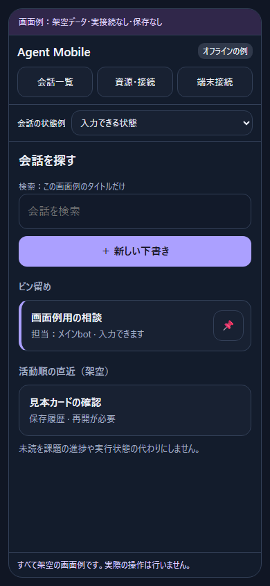
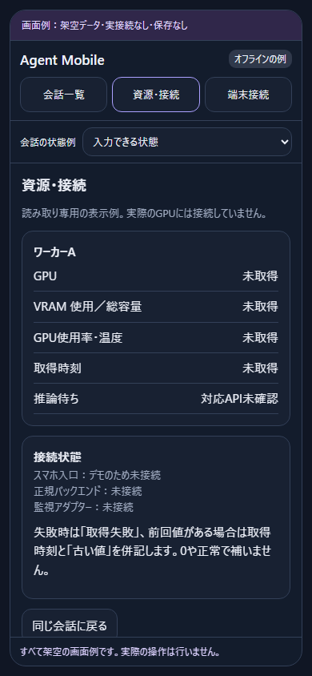

# 画面例・操作の読み方

[操作できる画面例](../examples/phone-ui.html) は、ダウンロードしてブラウザで開くオフラインHTMLです。GitHub上のHTML表示はソース閲覧であり、本番サービスの入口ではありません。実接続先、鍵、コードを入力しないでください。

これは実運用画面のスクリーンショットではなく、同種の操作を説明するために新規に作った架空データの見本です。実通信、ファイル読み取り、アップロード、推論、永続保存は行いません。再読込すると入力と状態は消えます。HTMLは単独で開けるようインラインCSS/JSを使っていますが、本番用CSPの雛形ではありません。実サービスではSECURITY-AUDIT.mdの要件に従って構築してください。

## 一覧

ピン留め・活動順の直近・検索・新しい下書きが入口です。見本の検索対象は画面内のタイトルだけ。実サービスの検索範囲やピン同期を模擬したものではありません。

## 会話

本文、成果物の位置、送信先、指示欄、添付、会話別モデル選択を示します。本文は切り詰めず、スレッド全体をスクロールします。「添付例」は架空のチップを表示するだけで、実ファイルを読みません。「送信例」は入力を画面内に追加するだけです。図版はCSSの見本で、動画プレイヤーは同梱していません。

## 資源・接続

資源と課題の進捗を分けます。監視値は未取得のまま表示し、実測値や推論待ちを捏造しません。GPU停止、サービス起動、モデル起動の操作はありません。「同じ会話に戻る」で入力を保持します。

## 操作と実装要件の対応

| 画面例で試せること | 本番で必要な正本・確認 | 受入ID |
|---|---|---|
| 一覧から会話を開く、ピンの表示を変える | 正規一覧、活動時刻、保存ID、共有pinの対応 | CHAT-01 / UI-01 |
| 新しい下書きを開く、会話ごとの入力を保持 | 初回送信時だけ正規create、保存ID/実行ID照合、添付移行 | CHAT-03 / CHAT-04 |
| 添付チップを表示/解除、送信表示 | 認証付きbytes受領、容量/型/対象検査、送信成功readback | FILE-02 / FILE-03 / CHAT-02 |
| 「会話の状態例」で承認待ち、許可/拒否 | 正規承認ID、対象会話、現在状態、返答後の結果確認 | CHAT-02 / CHAT-04 |
| モデル候補を選んで適用 | 正規候補、会話scope、費用警告同意、設定readback | MODEL-01 |
| 保存履歴を明示再開 | 勝手な推論継続なし、同保存IDの正規再開、能力検査 | CHAT-01 / OWN-02 |
| 使用中の引き継ぎを確認/取り消す | 正規close→解放確認→同保存ID再開、端末/owner世代束縛 | OWN-01 / OWN-02 |
| 接続切れの表示、送信例の無効化 | 不確定応答を再送しない、読み取り復帰と送信を分離 | CHAT-03 |
| 実行中の追加指示/停止の表示 | 正規APIの対応を確認。停止は対象実行だけ | CHAT-02 / RPC-01 |
| 資源画面との往復 | 読み取りアダプター、実測時刻、null/0/古い値の区別 | GPU-01 / GPU-02 / GPU-03 |
| 端末接続後の導線 | HTTPS、短期単回コード、個別失効、既存WSの失効 | AUTH-01 / AUTH-02 |

「会話の状態例」は説明用の切替です。本番の状態を利用者が自由に選ぶ機能として実装しないでください。送信先・実行状態・承認待ち・接続は正規API/イベントから表示します。

## 検証範囲と限界

オフラインHTMLのブラウザ試験で、画面往復、入力保持、モデル選択、承認拒否、引き継ぎ確認/取り消し、接続切れ時の送信抑止、添付/送信の表示、新規会話との分離を確認しました。狭幅・横向き相当を含む複数viewportで、横はみ出しと重複IDなしを確認しました。これはiPhone/Safari実機、正規バックエンド、承認/引き継ぎの実実行の合格ではありません。

同梱PNGは、このオフライン見本から撮影した画像だけです。実ページ、実会話、URLバー、端末名、機材情報、鍵、接続コードを含めていません。公開検査はPNGのsignatureとレビュー済みhashを検査しますが、画像内の秘密を自動検出するものではありません。差し替え時は視認レビューをやり直してください。

LLMには構成資料と併せて「見た目はこの例、動作の正本は各アダプターと受入条件」と伝えます。画面を似せるだけで認証や正規会話共有が完成したと判定しないでください。
